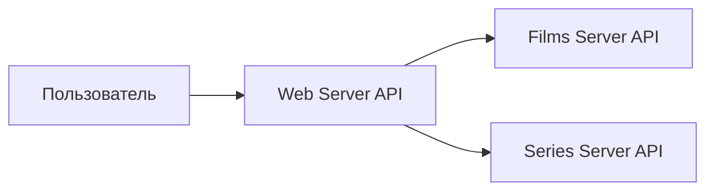

# Otium: доработка API стримингового сервиса

Учебный командный проект Яндекс Практикума (сентябрь 2026, команда из 3–4 аналитиков, проект принят ревьюером). Стриминговый сервис фильмов и сериалов Otium хочет помочь пользователям быстрее выбирать контент: добавить рейтинг кинокритиков и сортировку по рейтингам.

## 1. Контекст и требования

Источник требований — интервью с представителем заказчика. По итогам интервью зафиксированы:

- у каждого фильма и сериала появляется рейтинг кинокритиков (`criticsRating`); у части контента, например детского, его может не быть;
- пользователь сортирует список по зрительскому рейтингу или рейтингу кинокритиков, по возрастанию и убыванию;
- сначала применяются фильтры (например, по жанру), затем сортировка;
- **граничный случай:** контент без выбранного рейтинга (`null`) всегда выводится в конце списка, независимо от направления сортировки. Вариант «считать отсутствующий рейтинг нулём» отклонён: при сортировке по возрастанию такой контент оказался бы первым.

## 2. Архитектура



Web Server собирает список контента из двух сервисов и отдаёт его клиенту. Существующие методы всех трёх API изучены и протестированы в Swagger и через mock-серверы Postman.

## 3. Задача на разработку

| Поле | Значение |
|---|---|
| **Название** | Сортировка списка фильмов и сериалов по рейтингу зрителей и кинокритиков |
| **Цель** | Дать пользователям возможность быстрее выбирать контент для просмотра |
| **Требование** | Пользователь может сортировать список по полю `rating` или `criticsRating` по возрастанию (`asc`) или убыванию (`desc`). Контент без выбранного рейтинга (`null`) всегда в конце списка |
| **Use Case** | 1. В разделе «Библиотека» пользователь видит список фильмов и сериалов. 2. Пользователь выбирает фильтры и/или режим сортировки. 3. Система возвращает отфильтрованный и отсортированный список |
| **Контекст** | В ответах `films/list` и `series/list` уже есть зрительский рейтинг `rating` |

### Изменения в API (7 методов)

| № | Сервис | Метод | Изменение |
|---|---|---|---|
| 1.1 | Films Server | `GET /films/list` | Новое необязательное поле ответа `criticsRating` |
| 1.2 | Films Server | `GET /films?id=` | Новое необязательное поле ответа `criticsRating` |
| 2.1 | Series Server | `GET /series/list` | Новое необязательное поле ответа `criticsRating` |
| 2.2 | Series Server | `GET /series?id=` | Новое необязательное поле ответа `criticsRating` |
| 3.1 | Web Server | `GET /content/list` | Новые query-параметры `sortBy` и `direction` |
| 3.2 | Web Server | `GET /content/list` | Новое поле ответа `criticsRating` |
| 3.3 | Web Server | `GET /content/details` | Новое поле ответа `criticsRating` |

**Новые параметры запроса `GET {{WebServer}}/content/list`:**

| Параметр | Тип | Обязательность | Описание |
|---|---|---|---|
| `sortBy` | string | optional | Поле сортировки: `rating` или `criticsRating`. Контент без рейтинга — в конце списка при любом направлении |
| `direction` | string | optional | Направление: `asc` или `desc` |

**Новое поле ответа:**

| Поле | Тип | Обязательность | Описание |
|---|---|---|---|
| `criticsRating` | number | optional | Рейтинг кинокритиков. `null`, если рейтинг не выставлен |

**Пример запроса и ответа (сокращён):**

```http
GET {{WebServer}}/content/list?sortBy=criticsRating&direction=desc
```

```json
[
  { "id": 201, "type": "serie", "title": "Индийский океан и я", "genre": ["kids"], "rating": 9.5, "criticsRating": 8.4 },
  { "id": 101, "type": "film",  "title": "Хосэ Каньон",         "genre": ["comedy"], "rating": 9.4, "criticsRating": 7.4 }
]
```

Ошибки: изменения не требуются.

## 4. SOAP: XSD-схемы для фильтра по эксклюзивности

Отдельная задача спринта: фильтр «представлено эксклюзивно в Otium» в SOAP-версии метода `GetContentList`. Нужно было найти ошибки в XSD-схемах запроса и ответа и дополнить их. Фрагмент схемы запроса после доработки:

```xml
<xs:element name="GetContentList">
  <xs:complexType>
    <xs:sequence>
      <xs:element name="contentType" type="xs:string"/>
      <xs:element name="genreValue" type="xs:string"/>
      <xs:element name="exclusive" type="xs:boolean"/>
    </xs:sequence>
  </xs:complexType>
</xs:element>
```

В схему ответа `GetContentListResponse` в описание каждого элемента `content` добавлено поле `<xs:element name="exclusive" type="xs:boolean"/>`.

## 5. Что сделано

- Изучил интервью с заказчиком и сформулировал требование, включая граничный случай с отсутствующим рейтингом.
- Протестировал Web Server API, Films Server API и Series Server API в Swagger и определил, какие методы нужно доработать.
- Вместе с командой оформил тикет на доработку 7 методов API с примерами запросов и ответов.
- Исправил и дополнил XSD-схемы SOAP-запроса и ответа.
- Провёл с командой ретроспективу по схеме «Начать — прекратить — продолжить».

**Инструменты:** Swagger, Postman (mock-серверы), Google Docs, draw.io.
