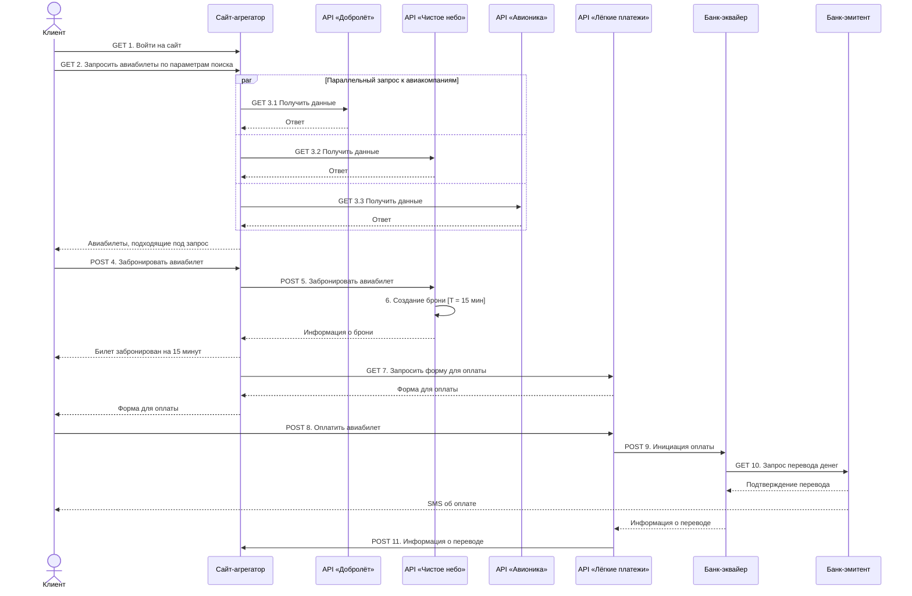

# Агрегатор авиабилетов: интеграция с авиакомпаниями и оплатой

Учебная работа Яндекс Практикума (сентябрь 2026), практика по UML Sequence. Задача — показать разработчикам, как сайт-агрегатор взаимодействует с внешними API при покупке авиабилета: поиск у нескольких авиакомпаний, бронирование и оплата с участием банков.

## Участники

| Участник | Роль |
|---|---|
| Клиент | Ищет, бронирует и оплачивает билет |
| Сайт-агрегатор | Собирает предложения и ведёт сценарий покупки |
| API авиакомпаний «Добролёт», «Чистое небо», «Авионика» | Отдают данные о рейсах, создают бронь |
| API платёжного сервиса «Лёгкие платежи» | Выдаёт форму оплаты и инициирует платёж |
| Банк-эквайер, банк-эмитент | Проводят перевод денег и уведомляют клиента |

## Диаграмма последовательности

Исходная диаграмма сделана в draw.io. Ниже она воспроизведена в Mermaid, чтобы GitHub показывал её прямо на странице.

## Решения, которые показывает диаграмма

- **Параллельный поиск** (`par`): агрегатор опрашивает три авиакомпании одновременно, а не по очереди, — ответ клиенту не ждёт самой медленной цепочки запросов.
- **Бронь с таймаутом 15 минут** создаётся на стороне авиакомпании до оплаты, чтобы место не ушло, пока клиент платит.
- **Оплата вне агрегатора:** клиент вводит данные карты в форме платёжного сервиса, агрегатор получает только результат перевода.
- **Банковская цепочка:** платёжный сервис → банк-эквайер → банк-эмитент; эмитент подтверждает перевод и отправляет клиенту SMS.

**Инструменты:** draw.io (UML Sequence), Mermaid.
