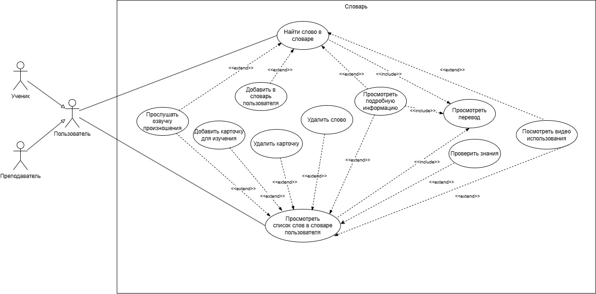

# Chatty 2.0: спецификация требований (SRS)

Учебная работа Яндекс Практикума (апрель 2026). Chatty — веб-приложение для изучения английского языка с учениками и преподавателями. Во второй версии появляются словарь (перевод, озвучка, видео с примерами употребления) и карточки для запоминания слов. Спецификация написана по шаблону К. Вигерса, варианты использования — в формате А. Коберна.

## Use Case диаграмма

## Содержание спецификации

| Раздел | Что в нём |
|---|---|
| Классы пользователей | Ученик (542 активных, ~2 сеанса в неделю), преподаватель (53, ~7 часов в день, в основном с ПК) |
| Операционная среда и ограничения | Chrome 56+, Safari 8.0–14.0; Red Hat Linux + Apache; PostgreSQL; HTML 5.0 |
| Предположения и зависимости | Работа словаря зависит от подключаемых библиотек словарей, аудио- и видеофайлов |
| Варианты использования | 11 сценариев: найти слово, прослушать озвучку, добавить в словарь пользователя, подробная информация, список слов, удалить слово, перевод, добавить и удалить карточку, проверить знания, видео использования |
| Функциональные требования | Иерархия `Словарь.Поиск`, `Словарь.Видео`, `Словарь.СловарьПользователя`, `…Карточки` |
| Требования к данным | Словарь данных: оригинал и перевод слова (до 30 символов), озвучка `.mp3`, видео `.mp4`, никнейм (до 25 символов), роль |
| Внешние интерфейсы | ПрИ-1 — подключаемый словарь (перевод, озвучка, варианты правильного написания), ПрИ-2 — библиотека видео, КИ-1 — email-уведомления |
| Атрибуты качества | См. ниже |
| Бизнес-правила | БП-1: слово не добавляется в словарь дважды; БП-2: в словарь пользователя добавляет только он сам; БП-3: у видео указаны источник и автор |

## Пример варианта использования

| | |
|---|---|
| **ВИ-1** | Найти слово в словаре |
| Основное действующее лицо | Преподаватель, ученик |
| Предусловие | Пользователь авторизован |
| Минимальные гарантии | Слово не найдено |
| Гарантии успеха | Слово найдено в словаре |
| Триггер | Пользователь столкнулся с неизвестным словом |
| Базовый сценарий | 1. Пользователь открывает словарь. 2. Вводит текст в строку поиска. 3. Система показывает переводы. 4. Пользователь просматривает переводы |
| Расширение 3а | Слово не найдено: система сообщает об этом и предлагает правильное написание; пользователь выбирает вариант, система возвращается к шагу 3 |

## Измеримые нефункциональные требования

| ID | Требование |
|---|---|
| УИ-1, УИ-2 | Добавить или удалить слово из словаря пользователя — одной операцией |
| УИ-3 | 99% новых пользователей находят незнакомое слово с первой попытки |
| Про-1 | 2000 пользователей, 500 в пиковый час (9:00–10:00), средний сеанс 70 минут |
| Про-2 | Страница полностью загружается не дольше 3 секунд при подключении 100 Мбит/с |
| Про-3 | Слово добавляется в словарь в среднем за 1 секунду, не дольше 5 секунд |
| Про-4 | Видео загружается не дольше 5 секунд при подключении 100 Мбит/с |
| Без-1, Без-2 | Все действия только после авторизации; пользователь видит только свой словарь |
| Дос-1 | Доступность 99% с 3:00 до 0:00 и 95% с 0:00 до 3:00, кроме планового обслуживания |
