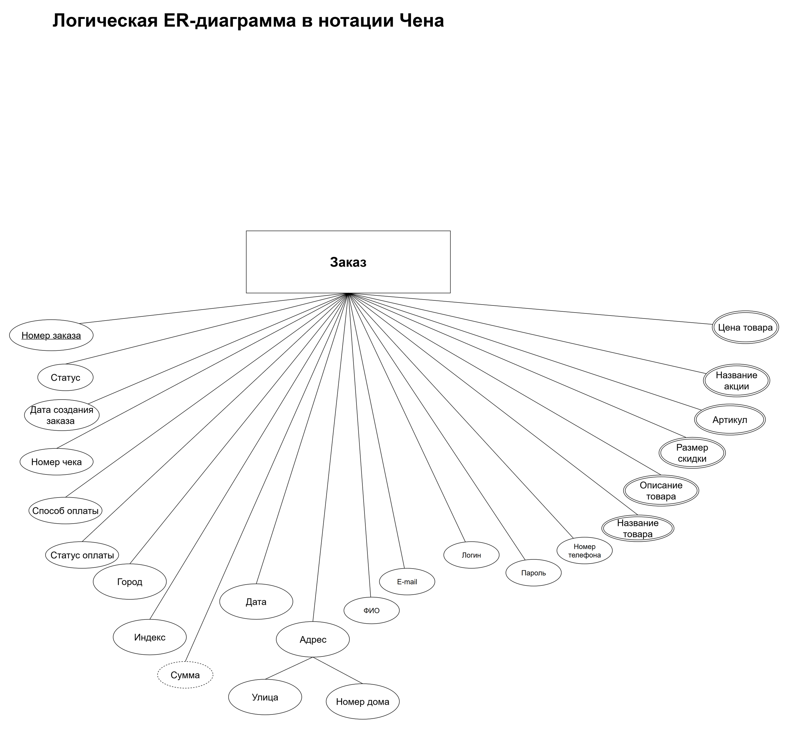
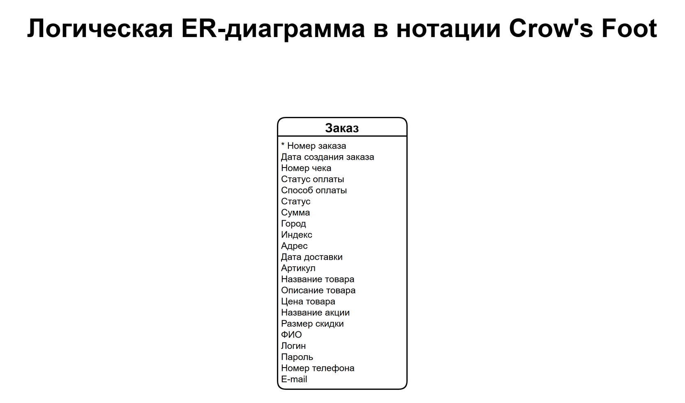
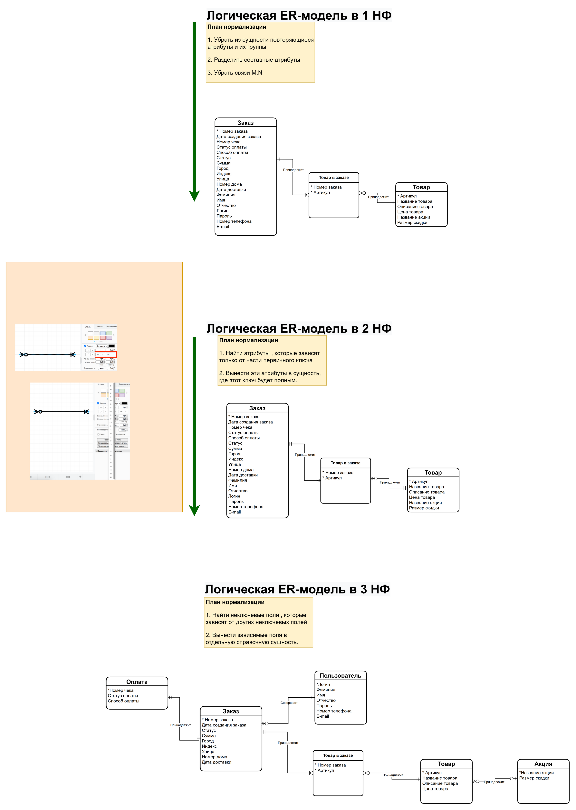

# Моделирование данных: ER-модель заказа и нормализация

Учебная работа Яндекс Практикума (май–июнь 2026). По диаграмме вариантов использования интернет-магазина нужно выделить основную сущность «Заказ», описать её логическую модель в двух нотациях и привести модель к третьей нормальной форме.

## 1. Нотация Чена

Сущность «Заказ» со всеми атрибутами: ключевой (номер заказа), составной (адрес → улица, номер дома), производный (сумма, пунктир), многозначные (атрибуты товара, двойной контур).

## 2. Нотация Crow's Foot

## 3. Нормализация до 3НФ

| Шаг | Что сделано |
|---|---|
| 1НФ | Убраны повторяющиеся группы и составные атрибуты; связь M:N «Заказ — Товар» разбита через сущность «Товар в заказе» |
| 2НФ | Атрибуты, зависящие от части ключа, вынесены в сущности, где ключ полный |
| 3НФ | Транзитивные зависимости вынесены в справочные сущности: «Оплата», «Пользователь», «Акция» |

Итоговая модель: Заказ, Пользователь, Оплата, Товар в заказе, Товар, Акция.

**Инструменты:** draw.io.
