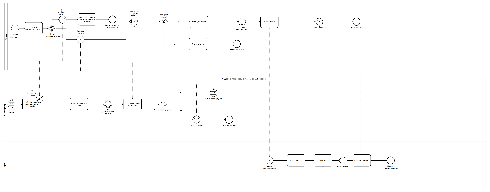
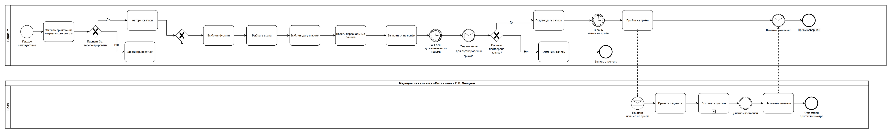
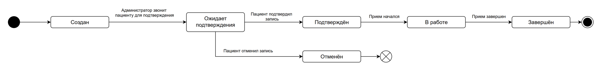
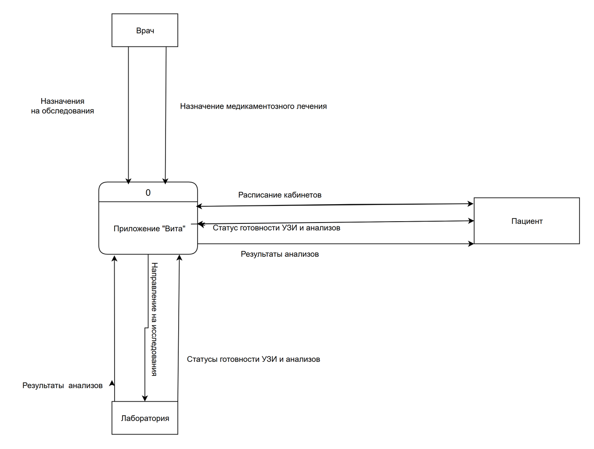
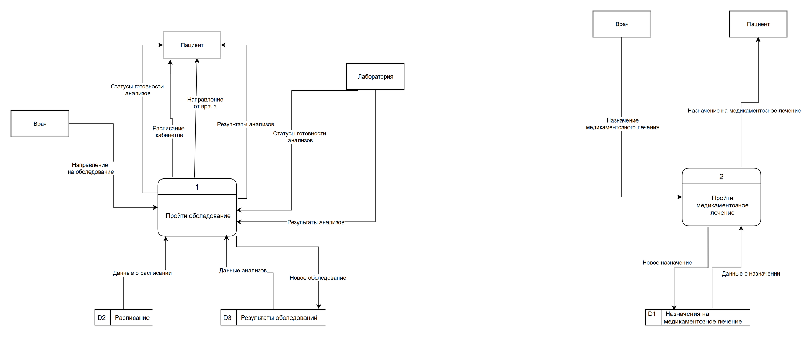

# Медицинская клиника: онлайн-запись к врачу

Учебные работы Яндекс Практикума (июль–август 2026). Пациенты записываются к врачу по телефону через администратора; клиника хочет приложение, в котором пациент записывается сам, а врач назначает обследования и лечение.

## 1. Процесс «как есть» (BPMN)

Составлен по интервью с администратором, пациентом и врачом. Три участника: пациент, администратор и врач клиники; запись и подтверждение идут через телефонные звонки.

## 2. Процесс «как будет» (BPMN)

Администратор исключён из процесса: пациент сам авторизуется или регистрируется в приложении, выбирает филиал, врача, дату и время, получает напоминание за день до приёма и подтверждает или отменяет запись.

## 3. Жизненный цикл записи (UML State Machine)

Создан → Ожидает подтверждения → Подтверждён → В работе → Завершён; из «Ожидает подтверждения» запись может быть отменена пациентом.

## 4. Потоки данных (DFD)

**Контекстная диаграмма:** приложение «Вита» и внешние сущности — врач, пациент, лаборатория.

**Логические диаграммы уровня 1:** процессы «Пройти обследование» и «Пройти медикаментозное лечение» с хранилищами данных D1–D3 (назначения, расписание, результаты обследований).

**Инструменты:** draw.io (BPMN 2.0, UML, DFD).
