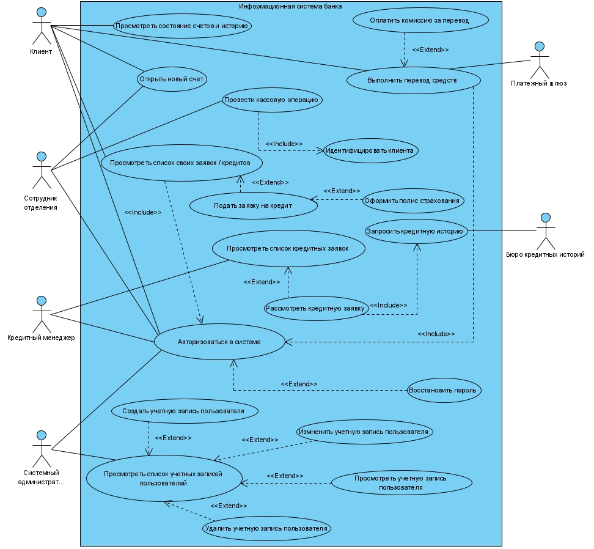
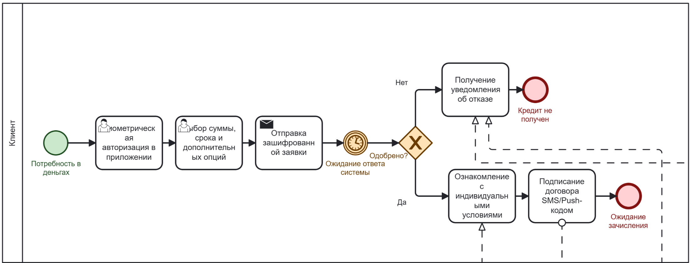
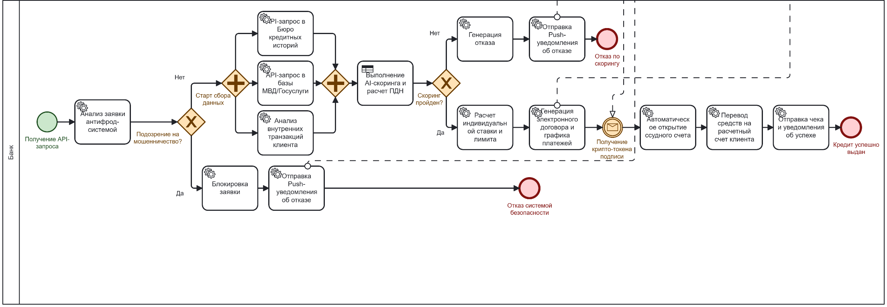
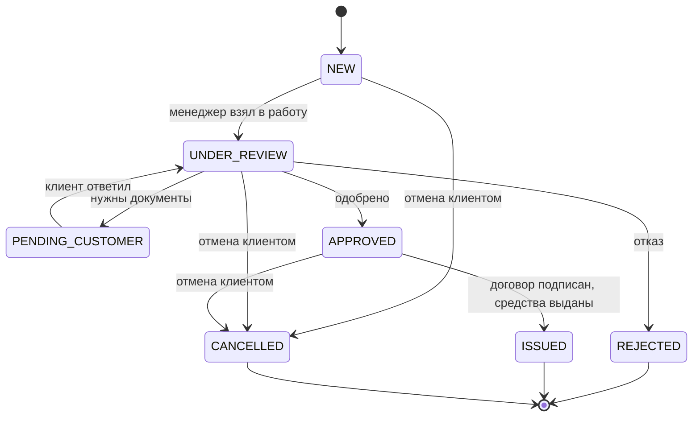
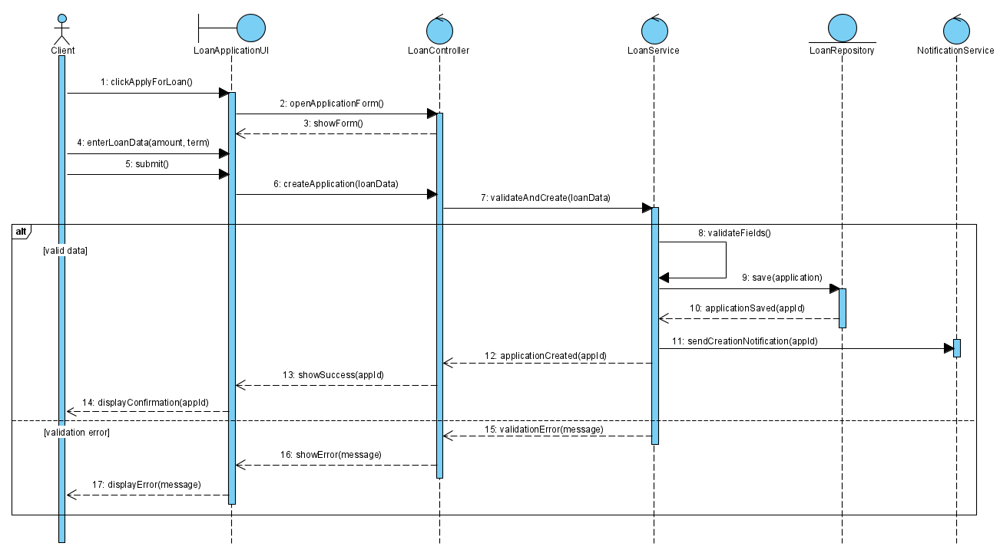
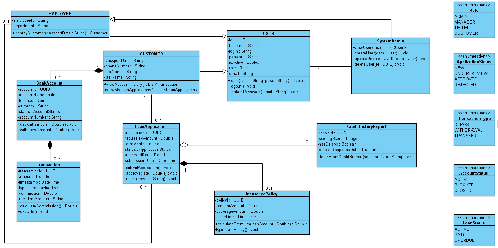

# Информационная система банка

Учебный курсовой проект по дисциплине «Технологии проектирования программного обеспечения»: модель информационной системы банка с регистрацией клиентов, счетами, транзакциями и обработкой кредитных заявок.

## 1. Контекст и бизнес-проблема

Без единой системы банк обрабатывает заявки вручную: клиент приходит в отделение, документы заполняются на бумаге, заявка передаётся между отделами, данные хранятся в разрозненных таблицах, заметках и письмах. Из-за этого сложно отследить статус заявки и историю клиента, растёт риск потери информации. Проект описывает автоматизированный процесс: заявка подаётся через приложение, система проверяет данные, запрашивает кредитную историю, выполняет скоринг и уведомляет клиента.

## 2. Цели и стейкхолдеры

**Цели:** сократить время обработки операций, обеспечить целостность и безопасность финансовых данных, повысить прозрачность работы отделений и специалистов.

| Роль | Что делает в системе |
|---|---|
| Клиент | Смотрит счета и историю операций, открывает счета, переводит средства, подаёт кредитную заявку |
| Сотрудник отделения | Проводит кассовые операции, подаёт заявки от лица клиентов |
| Кредитный менеджер | Работает со списком кредитных заявок и рассматривает их |
| Системный администратор | Управляет учётными записями и доступом |
| Внешние системы | Платёжный шлюз и бюро кредитных историй |

## 3. Моя роль

Автор проекта: самостоятельно выполнил анализ задания, составил глоссарий и дополнительные спецификации, описал варианты использования и построил все диаграммы.

## 4. Что сделано

- Постановка задачи, глоссарий (12 терминов), дополнительные спецификации: функциональность, интерфейс, надёжность, производительность (отклик до 5 секунд), безопасность, ограничения.
- BPMN «как есть» (3 фрагмента) и «как будет» (2 фрагмента) для обработки заявки клиента.
- Диаграмма вариантов использования с четырьмя ролями и двумя внешними системами, отношения include и extend.
- Подробное описание пяти вариантов использования: основной сценарий кредитного менеджера и CRUDL для учётной записи.
- UML: последовательность и кооперация для «Подать заявку на кредит», классы, состояния кредитной заявки, активность рассмотрения заявки, компоненты (микросервисы), размещение.

## 5. Артефакты

| Артефакт | Описание | Файл |
|---|---|---|
| Глоссарий | Термины предметной области | [glossary.md](01-requirements/glossary.md) |
| Дополнительные спецификации | Нефункциональные требования | [additional-specs.md](01-requirements/additional-specs.md) |
| Описание вариантов использования | 5 сценариев в табличном формате | [use-cases.md](01-requirements/use-cases.md) |
| Диаграммы | 13 диаграмм в формате изображений | [02-diagrams](02-diagrams/) |

## 6. Ключевые диаграммы

**Варианты использования**

**Процесс «как будет»: автоматическая обработка заявки**

**Жизненный цикл кредитной заявки (Mermaid, по диаграмме состояний [10-state-loan-application.png](02-diagrams/10-state-loan-application.png))**

**Сценарий «Подать заявку на кредит» и классы системы**

Остальные диаграммы: [кооперация](02-diagrams/08-collaboration-loan-application.png), [активность рассмотрения заявки](02-diagrams/11-activity-loan-review.png), [компоненты](02-diagrams/12-component.png), [размещение](02-diagrams/13-deployment.png).

## 7. Стек и инструменты

UML, BPMN, Use Case, CRUDL-анализ. В модели предполагается: Java, реляционная СУБД, микросервисная архитектура (API Gateway, сервисы авторизации, счетов, транзакций, кредитования), интеграции через REST/JSON, SOAP/XML, SMPP, S3 API. Диаграммы построены в MS Visio и draw.io.

## 8. Результат

Подтверждённый результат: комплект моделей и описаний системы. Реализации нет: проект учебный.

## 9. Что бы я улучшил

- Добавить ER-модель и словарь данных: сейчас структура данных описана только на диаграмме классов.
- Описать остальные варианты использования с тем же уровнем детализации.
- Добавить критерии приёмки и измеримые нефункциональные требования помимо времени отклика.
