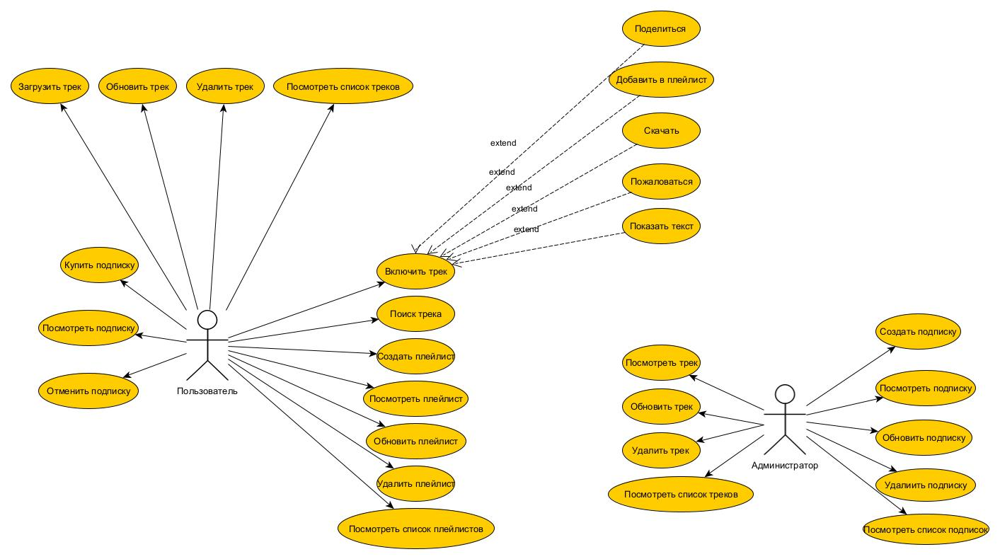
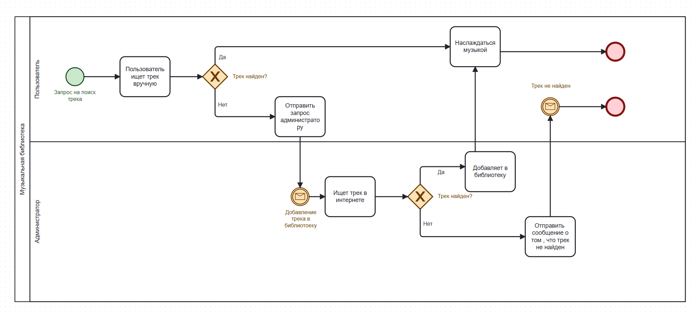
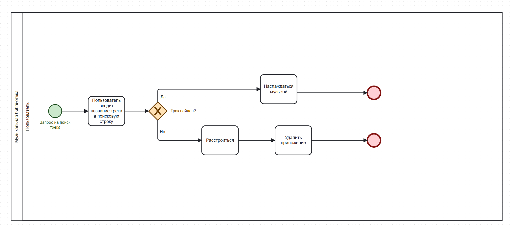
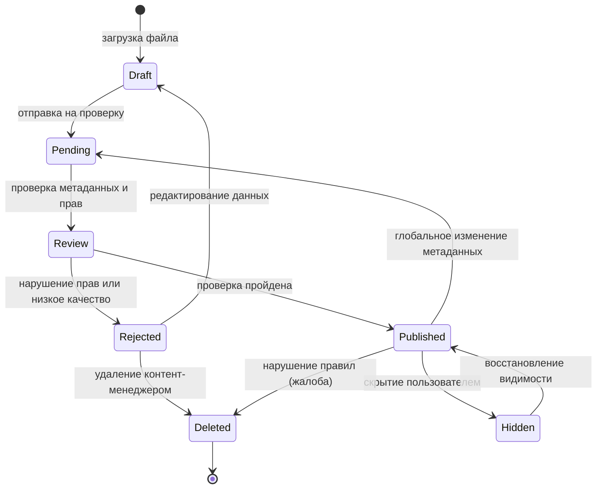
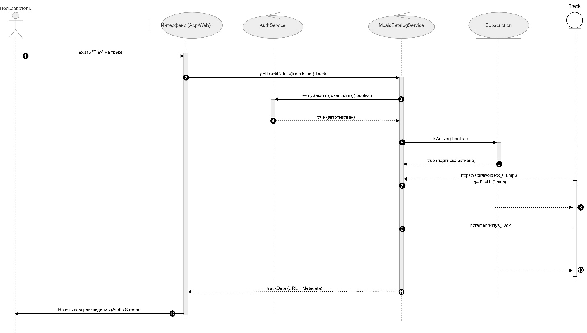
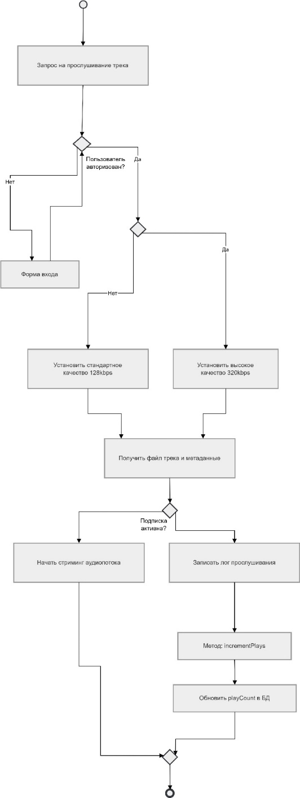

# Система управления музыкальными треками

Учебный курсовой проект по дисциплине «Технологии проектирования программного обеспечения»: анализ задачи и UML/BPMN-модель информационной системы для каталогизации, загрузки, модерации и воспроизведения музыки.

## 1. Контекст и бизнес-проблема

Музыкальный каталог ведётся вручную: контент добавляют и проверяют администраторы, пользователи ищут композиции без единой системы. Проект описывает систему, которая автоматизирует хранение, каталогизацию, поиск и воспроизведение треков, работу с плейлистами, подписками и модерацию загруженного контента.

## 2. Цели и стейкхолдеры

**Цели:** сократить время обработки нового контента, исключить дублирование данных, дать пользователям быстрый доступ к каталогу.

| Роль | Что делает в системе |
|---|---|
| Гость | Просматривает каталог и ищет треки без регистрации |
| Слушатель | Слушает треки, формирует плейлисты, ведёт избранное |
| Исполнитель | Загружает свои треки и управляет метаданными |
| Администратор | Модерирует контент, управляет пользователями и подписками |

## 3. Моя роль

Автор проекта: самостоятельно выполнил анализ задания, составил глоссарий и дополнительные спецификации, описал варианты использования и построил все диаграммы.

## 4. Что сделано

- Постановка задачи и анализ предметной области.
- Глоссарий (13 терминов) и дополнительные спецификации: функциональность, удобство использования, надёжность, производительность, безопасность, проектные ограничения.
- Диаграмма вариантов использования (2 актора: пользователь и администратор) и подробное описание пяти сценариев с основным и альтернативными потоками, пред- и постусловиями.
- Бизнес-процесс поиска трека в нотации BPMN: «как есть» и «как будет».
- UML-модели: классы, состояния трека, последовательность и кооперация для сценария воспроизведения, активность, размещение.

## 5. Артефакты

| Артефакт | Описание | Файл |
|---|---|---|
| Глоссарий | Термины предметной области | [glossary.md](01-requirements/glossary.md) |
| Дополнительные спецификации | Нефункциональные требования и ограничения | [additional-specs.md](01-requirements/additional-specs.md) |
| Описание вариантов использования | 5 сценариев: загрузить, обновить, удалить трек, посмотреть список, удалить трек администратором | [use-cases.md](01-requirements/use-cases.md) |
| Диаграммы | 9 диаграмм в формате изображений | [02-diagrams](02-diagrams/) |

## 6. Ключевые диаграммы

**Варианты использования**

**Бизнес-процесс поиска трека: «как есть» (вручную через администратора) и «как будет» (поиск в системе)**

**Жизненный цикл трека (Mermaid, по диаграмме состояний [05-state-track.jpg](02-diagrams/05-state-track.jpg))**

**Воспроизведение трека: последовательность и активность**

В сценарии воспроизведения система проверяет авторизацию и подписку: при активной подписке поток 320 kbps, иначе 128 kbps. Остальные диаграммы: [классы](02-diagrams/04-class-diagram.jpg), [кооперация](02-diagrams/07-collaboration.png), [размещение](02-diagrams/09-deployment.jpg).

## 7. Стек и инструменты

UML, BPMN, диаграммы Use Case. Предполагаемый стек в модели размещения: клиентское приложение (JS/Mobile), API-сервер, реляционная БД (PostgreSQL/MySQL), облачное хранилище аудио (S3), платёжный шлюз. Диаграммы построены в MS Visio и draw.io.

## 8. Результат

Подтверждённый результат: комплект моделей и описаний, достаточный, чтобы обсудить решение и начать разработку. Реализации и внедрения нет: проект учебный.

## 9. Что бы я улучшил

- Привести в соответствие описания сценариев и диаграмму вариантов использования: в списке есть «создать подписку», на диаграмме «купить подписку».
- Расширить модель «как будет» для BPMN: сейчас показан только поиск трека.
- Нарисовать диаграмму классов крупнее и с чётче видимыми связями.
- Добавить диаграмму компонентов и ER-модель данных.
