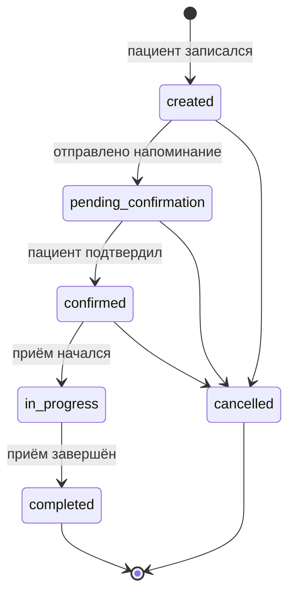
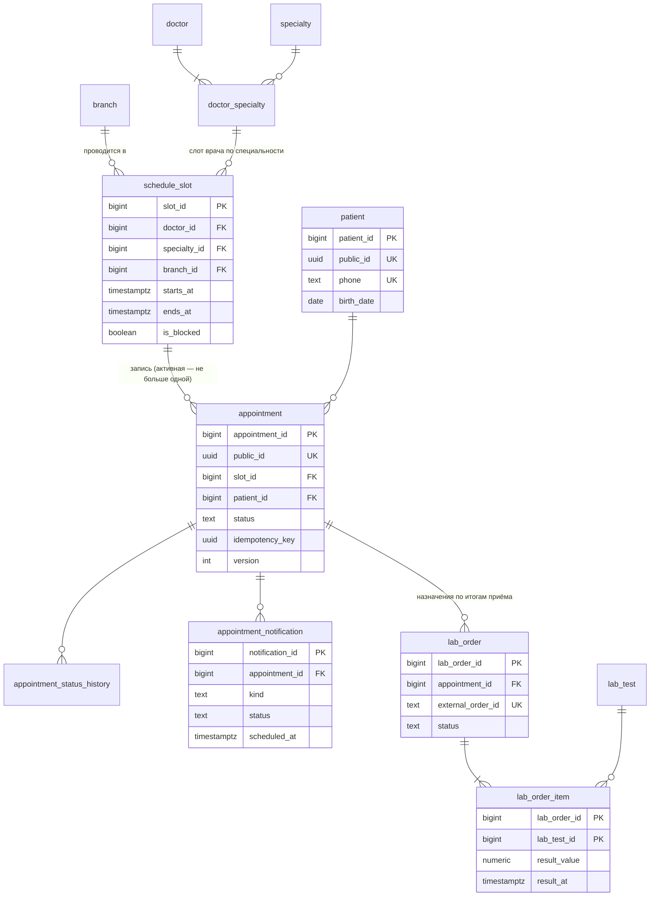

# Онлайн-запись к врачу: модель данных PostgreSQL

Демо-кейс (ноябрь 2026): база данных сервиса онлайн-записи в частную клинику с несколькими филиалами. Развитие учебного проекта [«Медицинская клиника»](../07-clinic-appointment/README.md): там процессы и потоки данных, здесь — физическая модель, готовая к передаче разработчикам.

**Файлы:** [schema.sql](schema.sql) — DDL · [seed.sql](seed.sql) — тестовые данные · [queries.sql](queries.sql) — основные запросы.
**Проверено:** скрипты выполнены на PostgreSQL 15.2; запросы и ограничения проверены сценариями ниже.

## 1. Что поддерживает модель

| Сценарий | Как обеспечено |
|---|---|
| Пациент видит свободные слоты по специальности и филиалу | Q1 + частичный индекс по незаблокированным слотам |
| Пациент записывается, повторное нажатие «Записаться» не создаёт дубль | Q2 + `UNIQUE (patient_id, idempotency_key)` |
| Два пациента не займут один слот, даже нажав одновременно | частичный `UNIQUE (slot_id) WHERE status <> 'cancelled'`, а не «SELECT, потом INSERT» |
| После отмены слот снова доступен | отменённая запись не участвует в уникальности |
| Врач не может принимать в двух местах одновременно | `EXCLUDE USING gist` по врачу и пересечению интервалов |
| Врач ведёт приём только по своим специальностям | составной FK слота на `doctor_specialty` |
| Статус меняется только по жизненному циклу, без потерянных обновлений | Q4: список допустимых переходов + оптимистическая блокировка `version` |
| Напоминание за 24 часа отправляется один раз, несколько воркеров не мешают друг другу | `UNIQUE (appointment_id, kind)` + Q5 с `FOR UPDATE SKIP LOCKED` |
| Результаты анализов приходят из лаборатории частями | `lab_order` с номером заказа во внешней ЛИС + позиции с результатами |

## 2. Жизненный цикл записи

Отмена требует причины (`CHECK`), каждый переход пишется в `appointment_status_history`.

## 3. ER-диаграмма

## 4. Ключевые решения

- **Идентификаторы.** Внутренние ключи — `BIGINT IDENTITY` (компактные индексы, быстрые JOIN). Во внешнем API — `public_id UUID`: внутренние номера не раскрываются, записи нельзя перебрать.
- **Статусы — `CHECK`, а не справочник.** Список стабильный, без собственных атрибутов; допустимые переходы проверяются в Q4.
- **Время — `TIMESTAMPTZ`** в UTC; часовой пояс хранится у филиала, потому что он нужен для показа слотов.
- **Мягкого удаления нет.** Записи не удаляются, а отменяются статусом; FK — `RESTRICT`. Исключение — `lab_order_item … ON DELETE CASCADE`: позиция не существует без назначения.
- **Без JSONB и денормализации**: для этих сценариев не нужны.

## 5. Транзакция создания записи

1. `BEGIN` (`READ COMMITTED` достаточно: от гонок защищают уникальные индексы).
2. Q2 — вставка записи. Пустой результат → откат и ответ 409 «Слот занят».
3. `INSERT` в `appointment_status_history` (`NULL → created`).
4. `INSERT` в `appointment_notification` (`reminder_24h`, время = начало слота − 24 ч).
5. `COMMIT`.

## 6. Проверки, выполненные на PostgreSQL 15

| Проверка | Результат |
|---|---|
| Повтор Q2 с тем же `idempotency_key` | возвращена та же запись, `created = false` |
| Второй пациент на занятый слот | 0 строк → 409 |
| Смена статуса со старой `version` | 0 строк → 409 |
| Переход `confirmed → completed` (минуя `in_progress`) | 0 строк |
| Слот врача, пересекающийся с другим его слотом в другом филиале | ошибка `ex_slot_doctor_no_overlap` |
| Слот по специальности, которой у врача нет | ошибка FK `fk_slot_doctor_specialty` |
| Отмена без причины | ошибка `ck_appointment_cancel_reason` |

## 7. Риски и открытые вопросы

| Вопрос | Влияние | Решение по умолчанию |
|---|---|---|
| Хранить ли персональные данные пациента в той же БД, что и расписание | Доступ, аудит, требования к медданным | Отдельная роль БД с доступом к `patient`; в логах только `public_id` |
| Сроки хранения результатов анализов | Объём `lab_order_item`, удаление | Уточнить с юристом клиники; до этого — не удалять |
| Объёмы | Нужна ли архивация слотов | Слоты прошлых периодов можно выносить в архив по месяцам после 1–2 млн строк |
| Перенос записи | Сейчас = отмена + новая запись | При требовании «одной операцией» — отдельный переход с историей |
